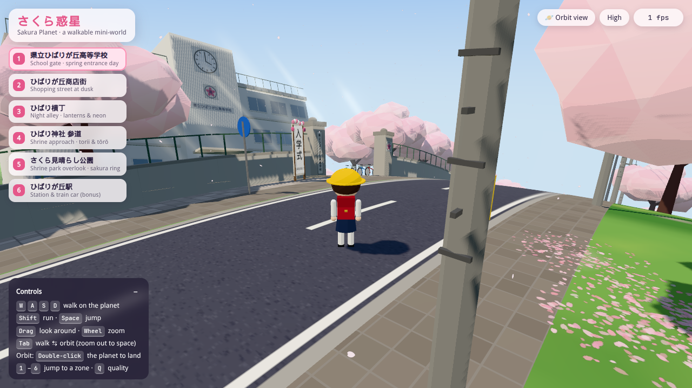
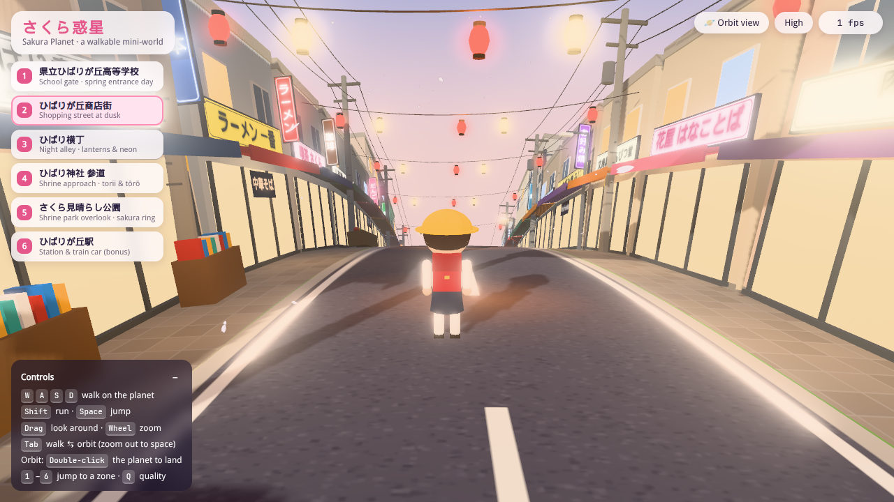
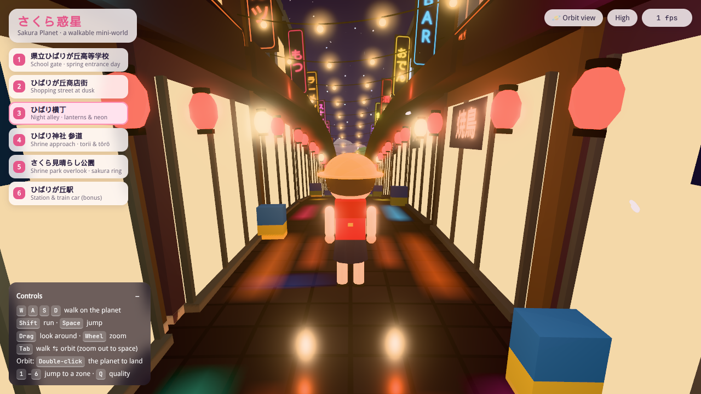
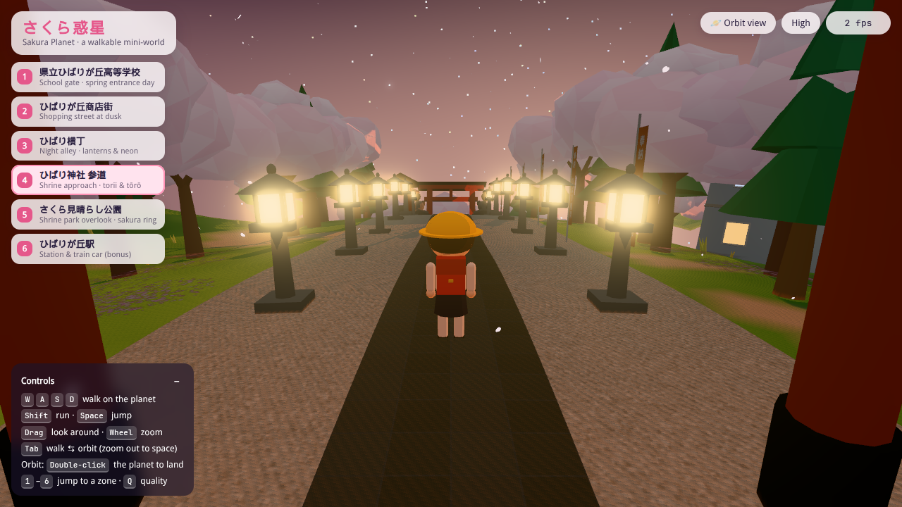
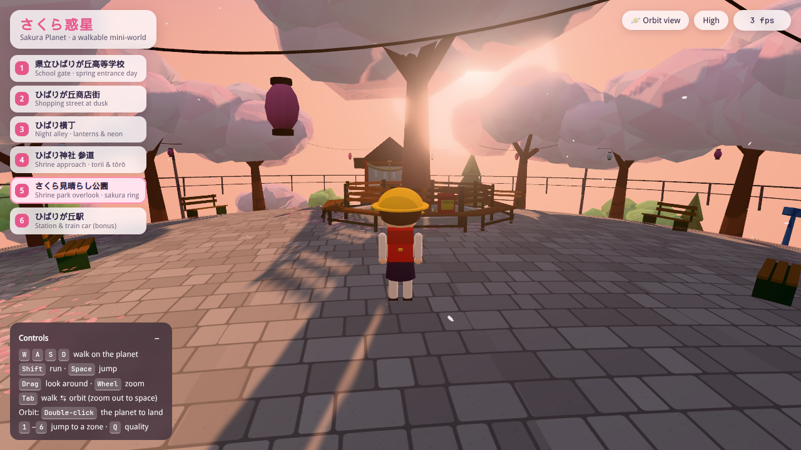
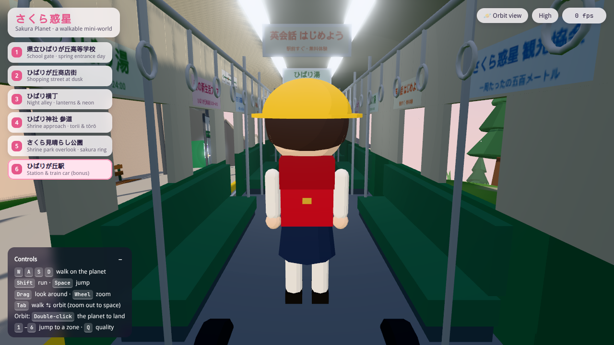
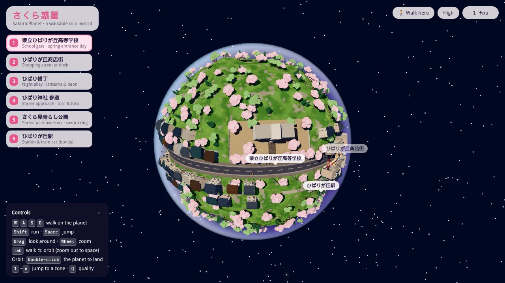

# さくら惑星 · Sakura Planet

A tiny **spherical** planet with an anime-style Japanese sakura town on its surface, built with **Vite + Three.js**. Walk the curved streets with real radial gravity, or zoom out to space and watch the whole mini-world turn.

Everything is generated from code: geometry, terrain, Japanese signs, petal and ground textures. There are no external GLB, HDRI or texture packs.



| | |
|---|---|
|  |  |
|  |  |
|  |  |

## Run it

```bash
npm i
npm run dev        # http://localhost:41731
```

`npm run build` writes a static bundle to `dist/` (relative paths, so it can be hosted anywhere), and `npm run preview` serves that bundle.

Requires Node 20.19+ (or 22.12+) and a WebGL2 browser (recent Chrome, Edge, Firefox or Safari).

## Controls

| Input | Action |
|---|---|
| `W` `A` `S` `D` / arrows | Walk on the planet surface |
| `Shift` | Run |
| `Space` | Jump |
| Drag (mouse / touch) | Look around |
| Mouse wheel | Zoom the follow camera; keep zooming out to fly to space |
| `Tab` or **🪐 Orbit view** | Toggle walk ⇄ orbit |
| Orbit: drag / wheel | Orbit and zoom around the whole planet (auto-rotates when idle) |
| Orbit: double-click the planet | Land at that spot |
| Orbit: **🚶 Walk here** / `Tab` | Land at the centre of the screen |
| `1`–`6` or the zone list | Travel to a zone |
| `Q` | Toggle High / Low quality |
| Touch | Left joystick to walk, 跳 to jump, drag to look |

## How the "real sphere" works

- **The planet is a true sphere** (radius 80 m, so one lap is about 500 m). The terrain is a displaced icosphere, with noise hills flattened under the ring road and each zone.
- **Local frames.** Each zone is authored in a flat local `(x, z)` frame that is mapped onto the sphere with the exponential map (`Frame` in `src/planet.ts`). Every building, tree, lantern and sign gets a matrix whose +Y is the outward surface normal, so everything stands upright wherever it sits.
- **Radial gravity.** The player moves in the tangent plane, is pulled toward the planet centre, and has its facing parallel-transported as it walks. The follow camera uses the local up, so the horizon always stays level, even when you walk "upside down" relative to where you started.
- **Collision on a sphere.** Obstacles are boxes and circles in their own tangent plane (`src/physics.ts`). Walkable floors (platform, train) support step-up.
- **One sun, real day and night.** The sun is fixed in space, and the zones are laid out around the planet so that the school sits at noon, the shopping street at dusk, the yokocho at night, and the shrine approach climbs from night toward a dawn overlook. Shadows follow the player on the surface and cover the whole planet from orbit.

## Zones

1. **県立ひばりが丘高等学校 — School gate.** Stone gate pillars with a vertical name plaque and a sakura crest, a 入学式 standing sign with paper flowers, a school building with a clock tower and 祝 入学 banner, a sakura avenue and slanting light shafts.
2. **ひばりが丘商店街 — Shopping street at dusk.** Twenty shops (ひばり書店, ラーメン 一番, 喫茶 さくら, 銭湯 ひばり湯 …) with awnings, blade signs and noren, utility poles with sagging wires, and chochin strings with 祭/春/桜/福 lanterns.
3. **ひばり横丁 — Night yokocho.** A narrow alley of snack bars and izakaya with neon blade signs, red lanterns, zig-zag string lights, vending machines and glossy wet stone with smeared neon reflections.
4. **ひばり神社 参道 — Shrine approach.** A vermilion torii with shimenawa, stone tōrō lanterns that really light the path, komainu (a-un pair), nobori banners, a chozuya basin, gravel and cedars.
5. **さくら見晴らし公園 — Circular shrine park and overlook.** A ring of sakura around a great tree with an octagonal wrap-around bench, with a yellow school hat and a 交通安全 randoseru resting on it. Also hanami lanterns, a small shrine hall, overlook railings and coin binoculars.
6. **ひばりが丘駅 — Station and train car (bonus).** A platform with a station name board and a level-crossing signal, plus a green-and-cream train car you can walk into, with longitudinal seats, straps, ceiling lights and hanging ads.

Between the zones are residential streets, utility poles along the whole ring road, and more than 500 instanced trees.

## Performance

The renderer is built to keep a normal laptop at 30 fps or more:

- Static scenery is merged into a few meshes per zone, with colours stored as vertex attributes. Trees are instanced per sphere cell.
- **Horizon culling.** On a small planet, anything past the horizon is hidden by the planet itself, so chunks behind it are skipped. A typical street-level frame is about 140 draw calls and 0.7 M triangles, including the shadow pass.
- A fixed pool of 8 point lights hops to the lanterns nearest the player, so the light count never changes and shaders never recompile.
- Lantern, neon and lamp halos are a single additive point cloud.
- **High** quality adds bloom, 2048² shadows and up to 1.5× pixel ratio. **Low** turns off bloom and uses 1024² shadows at 1× pixel ratio. The app switches to Low automatically if the frame rate stays under about 26 fps.

URL parameters for testing: `?zone=park`, `?mode=orbit` and `?quality=low`. `?fixedDt=0.05` uses a fixed timestep, which is useful for headless screenshots.

## Project layout

```
src/
  main.ts        renderer, post FX, walk/orbit cameras, HUD, input, culling
  planet.ts      radius, sun, terrain height, sphere Frame helper
  world.ts       planet mesh, ring road, neighbourhood filler, assembly
  builder.ts     merge-by-material geometry builder
  kit.ts         houses, shops, poles, wires, chochin, tōrō, torii, komainu…
  trees.ts       instanced sakura / round / cedar trees
  textures.ts    Canvas sign atlas (Japanese text) + procedural textures
  sky.ts         sky dome, starfield, atmosphere shell
  player.ts      character + spherical-gravity controller
  physics.ts     tangent-plane colliders and floors
  petals.ts      falling petals around the viewer
  glow.ts        glow point cloud + point-light pool
  zones/         school, shopping, yokocho, shrine (approach + park), station
```

Japanese text is drawn with your system fonts (Hiragino, Yu Gothic or Noto Sans/Serif JP, with fallbacks).

## Credits

- **Inspiration:** the sakura-town mood in [this post by @NFT_Chen](https://x.com/NFT_Chen/status/2110146921646223867). This project is an original, independent re-imagining. It contains no assets from that work, and all geometry, textures and code here are procedural and original.
- Built with [Three.js](https://threejs.org/) and [Vite](https://vite.dev/).

## 中文简介

一个可以自由漫游的**真球面**樱花小镇小行星（Vite + Three.js，全部程序化生成，没有使用外部模型、贴图或 HDRI）。用 WASD 在弯曲的地表上行走（重力指向星球中心，相机始终相对当地地面保持直立）；按 Tab 或滚轮拉远可以进入太空，环绕观看整个星球，在星球上双击即可降落。星球上有六个区域：校门、黄昏商店街、夜晚横丁、神社参道、环形樱花公园观景台，以及可以走进车厢的电车站。

## License

[MIT](LICENSE) © 2026 Sakura Planet contributors
