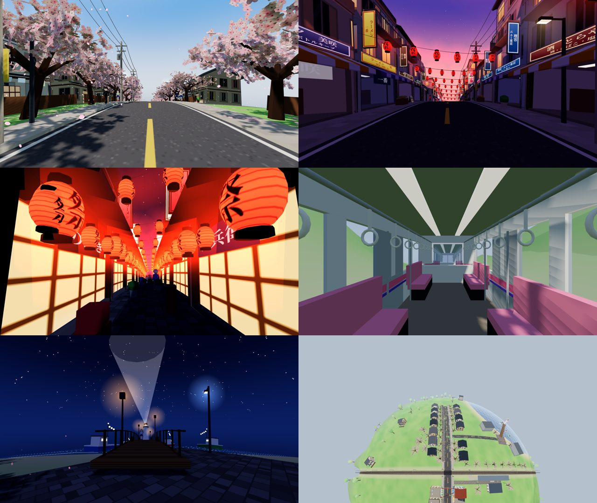
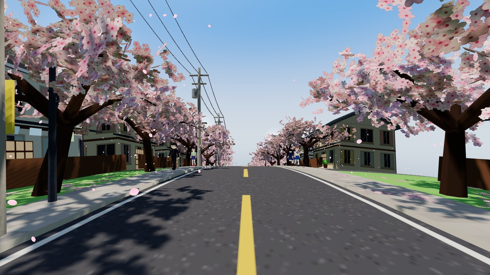
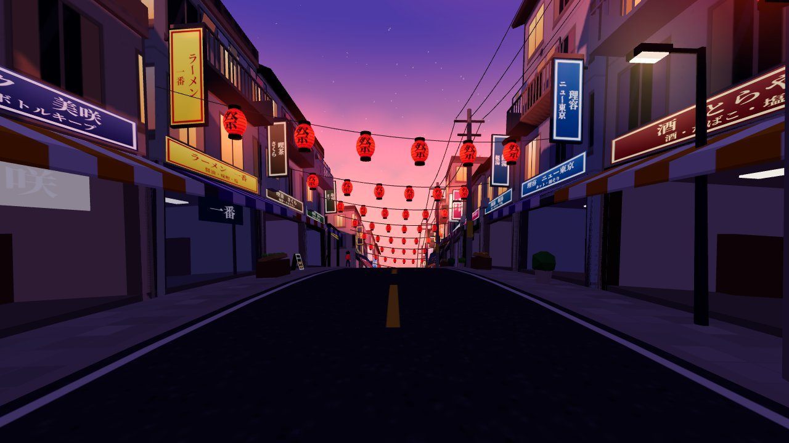
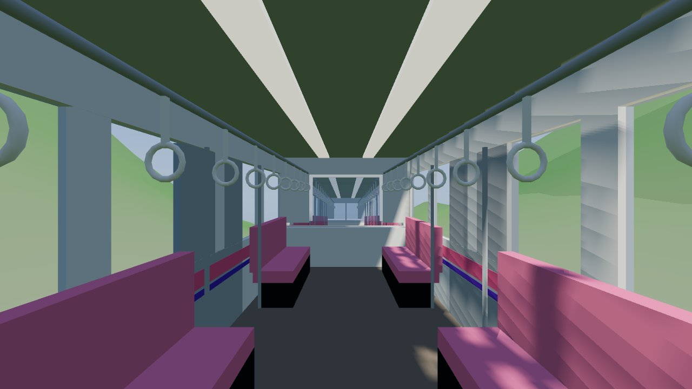
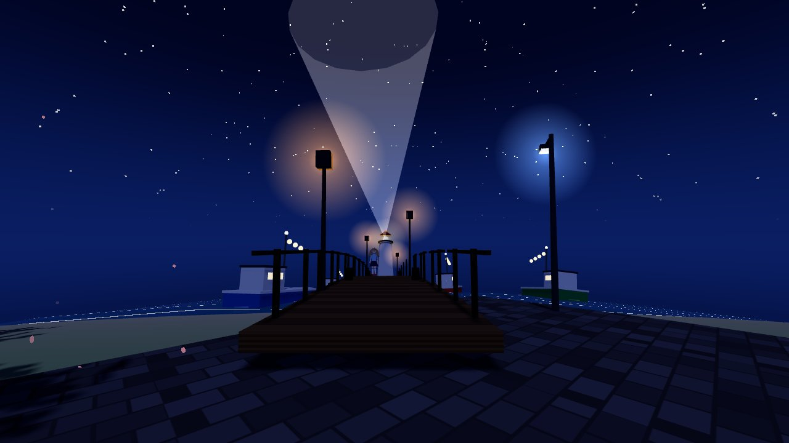
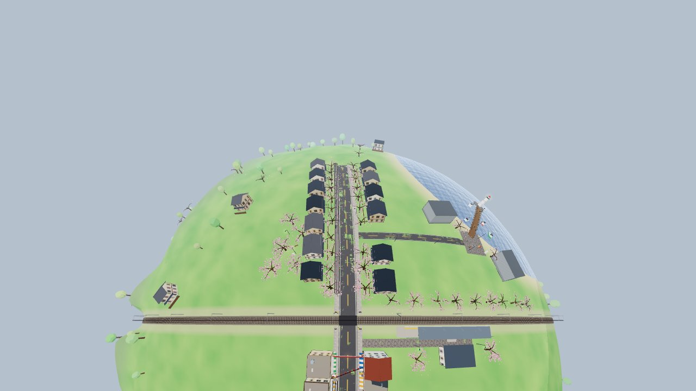

# 🌸 Sakura Town Planet · 樱花小镇星球

**A fully procedural, single-file Three.js anime sakura town wrapped around a tiny walkable planet.**
No models, no textures, no audio files — every signboard, petal, face, window and sound is generated at runtime.

**一个完全程序化生成、单文件的 Three.js 3D 动漫樱花小镇星球。** 没有任何外部模型、贴图或音频：招牌、花瓣、角色的脸、窗户和环境音全部在运行时由代码生成。



▶ **在线试玩 / Live demo:** https://raw.githack.com/2023Anita/sakura-town-planet/main/index.html
（GitHub Pages 开启后也可访问 / also at https://2023anita.github.io/sakura-town-planet/ once Pages is enabled）

---

## ✨ 功能 Features

| | 中文 | English |
|---|---|---|
| 🧩 | **全程序化单文件**：一个 `index.html`，Canvas 实时生成招牌纹理、花瓣、窗户、人物表情 | **Single procedural file**: one `index.html`; signs, petals, windows and faces drawn on `<canvas>` |
| 🏮 | **商店街**：多行日文招牌（スナック／やきとり／ラーメン…）、竖排突出招牌、条纹遮阳篷、店内纵深（货架、柜台、灯）、人行道展示物（自动贩卖机、水果摊、自行车、立牌）、楼上阳台晾衣 | **Shōtengai**: multi-line Japanese signboards, vertical tategaki signs, striped awnings, shop interiors with depth, sidewalk displays, balconies with drying laundry |
| 🌙 | **夜景氛围**：红纸灯笼串、湿润路面上的暖光倒影、蓝调阴影、路灯与窗户亮起、夜樱微光 | **Night mood**: red paper lantern strings, warm pools on wet asphalt, blue shadows, street lamps and windows lighting up |
| 🚃 | **交通系统**：铁路道口栏杆起落 + 红灯交替闪烁 + 警铃；通勤电车环绕星球运行并进站停车，透明车窗可见粉色长椅和吊环；站台细节 | **Railway**: level-crossing gates, alternating red lamps and bell; a commuter train circling the planet that stops at the station, with see-through windows, pink bench seats and hand straps |
| 🌸 | **樱花程序化**：染井吉野伞状树冠、约 3.9 万张实例化花簇卡片、着色器风吹摆动 + 持续飘落的花瓣 | **Procedural sakura**: Somei-Yoshino umbrella canopies, ~39k instanced blossom cards, shader wind sway and endlessly falling petals |
| 👧 | **动漫角色**：Canvas 绘制的会眨眼大眼脸、关节行走动画、水手服／学兰／便装、双色赛璐珞着色 + 描边；行人会在道口等电车通过 | **Anime townsfolk**: blinking canvas-drawn faces, jointed walk cycle, sailor uniforms / gakuran / casual wear, 2-tone cel shading + outlines; pedestrians wait at the crossing |
| 🌅 | **场景多样性**：白日樱花大道、黄昏紫调商店街、夜巷灯笼、电车车厢、夜景码头（灯塔光束、渔船、水面倒影） | **Scene variety**: daytime sakura avenue, purple-dusk shopping street, lantern alley, train interior, night harbour with lighthouse beam |
| 🎮 | **交互**：第一人称 WASD 漫游／飞行、碰撞检测、日夜切换与时间流动、上下电车、移动端摇杆、Web Audio 合成环境音 | **Interaction**: first-person WASD walk / fly, collisions, day–night cycle, ride the train, mobile joystick, synthesised Web Audio ambience |

## 🎮 操作 Controls

| 按键 Key | 作用 Action |
|---|---|
| `W A S D` / 方向键 | 移动 Move |
| 鼠标 Mouse | 视角（点击画面锁定，Esc 解锁）Look (click to lock pointer) |
| `Shift` | 奔跑 Run |
| `F` | 飞行 / 步行切换 Toggle flying · `Space` 上升 up · `C` 下降 down |
| `N` | 日夜切换 Day ↔ night |
| `T` | 时间流动 / 暂停 Toggle time flow |
| `E` | 上 / 下电车（电车靠站时）Board / leave the train |
| `M` | 静音 Mute |
| `1`–`7` | 场景传送 Teleport: 樱花大道 · 黄昏商店街 · 夜巷灯笼 · 车站与道口 · 列车车厢 · 夜景码头 · 星球全景 |
| `H` | 隐藏界面 Hide UI |

手机：左下摇杆移动，拖动屏幕转视角，右下按钮飞行 / 昼夜 / 上下车。
Mobile: left joystick to move, drag to look, buttons for fly / day-night / board.

## 🚀 本地运行 Run locally

不需要安装依赖、不需要编译、不需要 API Key。No install, no build, no API keys.

```bash
git clone https://github.com/2023Anita/sakura-town-planet.git
cd sakura-town-planet
npm start                     # → http://localhost:5173
# 没有 Node？ / no Node?
python3 -m http.server 5173   # → http://localhost:5173
```

> ⚠️ 请通过本地服务器打开，不要直接双击 `index.html`（浏览器会拦截 `file://` 下的 ES Module）。
> Open it through a local server, not via `file://`.

### 🤖 用 Codex 一键运行 Run with Codex

仓库根目录有 [`AGENTS.md`](AGENTS.md)，Codex 会自动读取其中的启动、验证和代码约定。把下面这句话交给 Codex 即可：

```text
Clone https://github.com/2023Anita/sakura-town-planet, follow AGENTS.md to start it, and confirm the console shows the "[sakura] built" line with no errors.
```

想在此基础上继续扩展场景，可以参考 [`PROMPT.md`](PROMPT.md) 里的原始设计提示词。
To extend the world, see the original design brief in [`PROMPT.md`](PROMPT.md).

## 🛠 技术要点 How it works

- **小星球映射 Tiny-planet mapping**：小镇先在平面地图上设计（x 向东、z 向南，单位米），再用指数映射包裹到半径 150 m 的球面上；铁路就是赤道。The town is authored on a flat map and wrapped onto a 150 m sphere; the railway is the equator.
- **静态合批 Static batching**：所有静态物件先按普通 Group 搭建，再按材质合并成少量网格，数千个部件只需几十次 draw call。Static scenery is merged per material — thousands of parts, a few dozen draw calls.
- **实例化 Instancing**：花簇、灯笼、晾晒衣物、地面光斑、树木全部用 `InstancedMesh`；花瓣飘落在顶点着色器中计算。Blossoms, lanterns, laundry, light pools and trees are instanced; falling petals run in a vertex shader.
- **三渲二 Toon look**：`MeshToonMaterial` + 自定义渐变贴图，角色使用双色阶与反向外壳描边。Toon materials with stepped gradient maps and inverted-hull outlines.
- **日夜系统 Day–night**：太阳方向跟随玩家所在位置的局部坐标系，天空、雾、水面、窗户、招牌、灯笼和路面湿润度随时间插值。Sun direction lives in the player's local frame; sky, fog, water, windows, signs, lanterns and road wetness follow the clock.
- **声音 Audio**：风、鸟鸣、虫鸣、海浪、道口警铃和电车「咣当咣当」都由 Web Audio 实时合成。All sound is synthesised with Web Audio.
- **性能 Performance**：触屏设备自动降低花瓣数量、阴影分辨率和像素比；URL 加 `?low` 可强制低画质。Touch devices use a lighter profile; add `?low` to force it.

## 📁 结构 Structure

```
index.html                  整个应用 the whole app
vendor/three.module.min.js  three.js r170（本地内置，不依赖 CDN / vendored, no CDN）
vendor/addons/              BufferGeometryUtils
serve.mjs                   零依赖静态服务器 zero-dependency static server (npm start)
AGENTS.md                   给 Codex / AI 编程助手的说明 instructions for coding agents
PROMPT.md                   设计提示词 design brief
docs/                       截图 screenshots
```

## 🖼 截图 Screenshots

| | |
|---|---|
|  白日樱花大道 |  黄昏商店街 |
|  夜巷灯笼 |  列车车厢 |
|  夜景码头 |  星球全景 |

## 🙏 致谢 Credits

- 灵感来自 [@NFT_Chen 的帖子](https://x.com/NFT_Chen/status/2110146921646223867)（Claude Opus + Three.js 生成的樱花小镇星球）。原作未公开源码，本仓库为根据其功能描述**独立重写**的开源实现。
  Inspired by [@NFT_Chen's post](https://x.com/NFT_Chen/status/2110146921646223867). The original source was not published; this repository is an **independent from-scratch re-implementation** based on its feature breakdown.
- [three.js](https://threejs.org/) — MIT License.

## 📄 License

[MIT](LICENSE) © 2026 Lixin Yin
